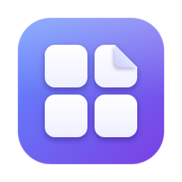
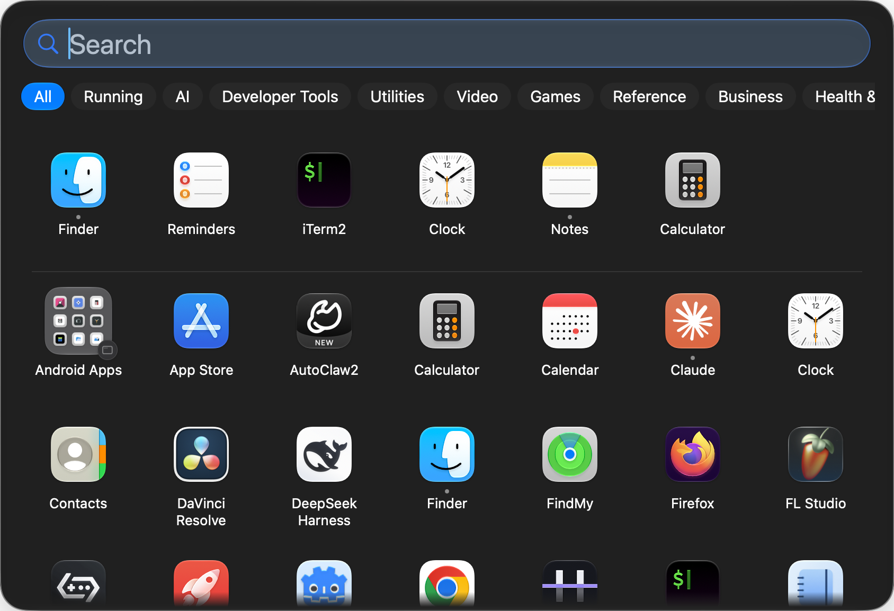
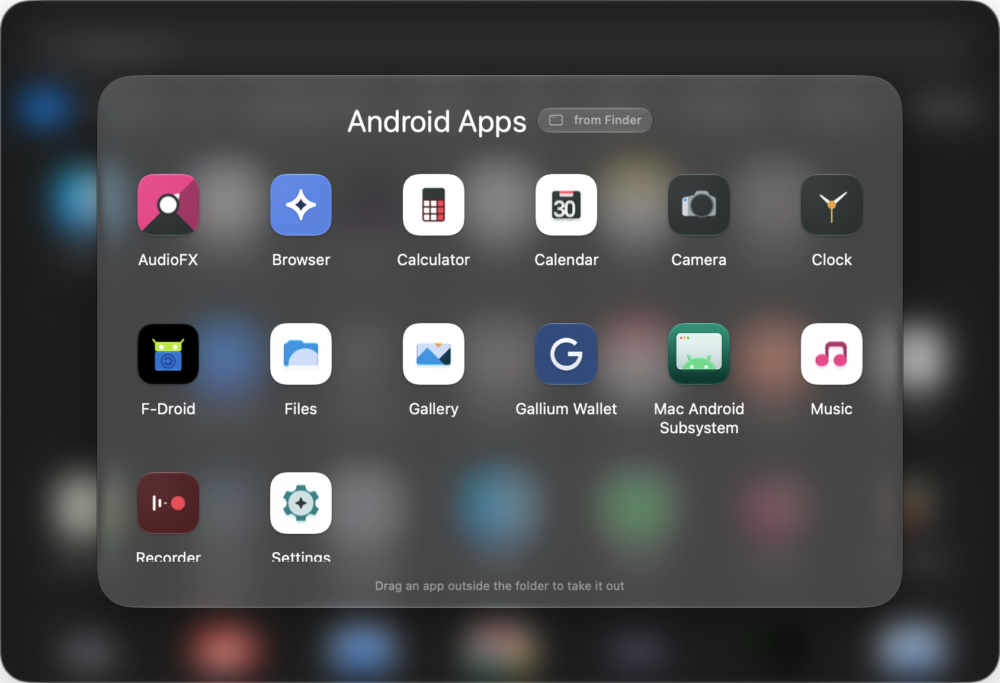
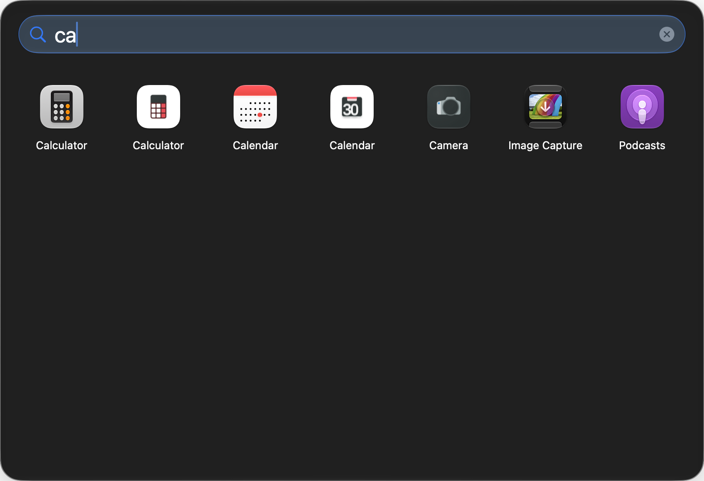
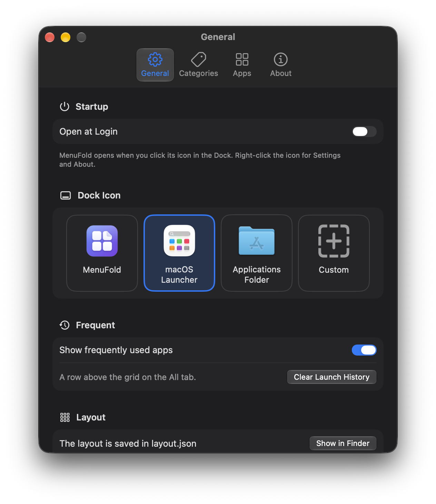

<p align="center">
  
</p>

<h1 align="center">MenuFold</h1>

<p align="center">
  An app launcher for the macOS Dock: every app in one grid, with your own folders, categories and search.<br>
  A replacement for the Dock's Applications stack, in Liquid Glass.
</p>

<p align="center">
  <a href="https://github.com/dsidxavekko/MenuFold/releases/latest"></a>
  <a href="https://github.com/dsidxavekko/MenuFold/actions/workflows/ci.yml"></a>
  
  
  <a href="LICENSE"></a>
</p>

<p align="center">
  
</p>

Pin MenuFold to the Dock like any other app. Click its icon and a panel opens in the middle of the screen
with all your apps. Click an app to launch it, or press Esc to close the panel.

MenuFold doesn't patch the Dock or any system process, so you don't need to change SIP. It also needs no
Accessibility or Screen Recording permission.

## Features

- **Every app in one grid.** Apps are found through Spotlight, so new installs show up on their own. Copies
  inside other bundles, helper apps under `/Library` and duplicates are skipped.
- **Folders.** Drop one app onto another to make a folder, just like on iPhone. You can rename a folder and
  pick its colour and an SF Symbol. Subfolders of `/Applications` (such as Utilities) appear as folders too.
  MenuFold never moves any files.
- **Category tabs.** Apps are sorted into tabs by their App Store category. You can move an app to another
  category, make your own categories, and drag tabs into any order.
- **Running tab.** The apps that are open right now, with a Dock-style dot under each one that is running.
- **Frequent apps.** The apps you open most often sit in a row above the grid.
- **Search.** Type to find an app, including apps inside folders. Names match in the system language and
  in English, so both «Калькулятор» and "Calculator" work.
- **Keyboard.** Use the arrow keys to move, Return to launch, ⌘R to show in Finder and ⌘⌫ to move to the
  Trash. Esc closes a folder, then the panel.
- **Per-app actions.** Right-click an app to open it, show it in Finder, quit it, hide it from the grid,
  give it a custom icon, change its category or move it to the Trash (MenuFold asks first).
- **Dock icon.** Choose the MenuFold logo, the macOS launcher icon, the Applications folder icon or your own
  picture.
- **English and Ukrainian** interface.

<table>
  <tr>
    <td></td>
    <td></td>
  </tr>
  <tr>
    <td align="center">An open folder</td>
    <td align="center">Search</td>
  </tr>
</table>

<p align="center">
  
</p>

## Install

1. Download `MenuFold-<version>-macos26-arm64.zip` from the
   [latest release](https://github.com/dsidxavekko/MenuFold/releases/latest) and unzip it.
2. Move `MenuFold.app` to `/Applications`.
3. Open it. The app is ad-hoc signed and not notarised, so macOS blocks the first launch. Go to
   **System Settings → Privacy & Security** and click **Open Anyway**.
4. Keep MenuFold in the Dock: right-click its icon → **Options → Keep in Dock**. You can then remove the
   Dock's own Applications stack.

Requires macOS 26 or later on Apple silicon.

To check the download, run `shasum -a 256 -c SHA256SUMS` in the folder that holds both files.

## Using it

| Action | How |
| --- | --- |
| Open or close the panel | Click MenuFold in the Dock |
| Launch an app | Click it, or select it and press Return |
| Make a folder | Drag an app onto another app (on the **All** tab, with an empty search) |
| Take an app out of a folder | Drag it outside the open folder |
| Rename a folder | Click its title while it is open |
| Reorder tabs | Drag a tab, or right-click it → Move Left / Move Right |
| Settings | ⌘, while MenuFold is active, or right-click its Dock icon |

Your layout (folders, categories, hidden apps, custom icons) is saved in
`~/Library/Application Support/MenuFold/`. **Settings → General → Show in Finder** takes you there.

## Privacy

MenuFold runs entirely on your Mac and makes no network requests. It reads:

- Spotlight metadata, to find apps;
- each app's `Info.plist`, for its name and category;
- the `com.apple.dock` preferences (tile size and orientation only), to tell whether a click came from the Dock.

It writes only inside `~/Library/Application Support/MenuFold/`. If `layout.json` gets damaged, MenuFold
moves it aside as `layout.corrupt-<date>.json` and warns you in Settings, so your old layout is not lost.

When you drag an app out of the panel, Finder can only make an alias of it. It cannot move or copy the app.

## Build from source

You need macOS 26+, Xcode with the macOS 26 SDK, and [XcodeGen](https://github.com/yonaskolb/XcodeGen)
(`brew install xcodegen`).

```bash
scripts/build.sh run          # generate the project, build Debug into ./build and launch it
scripts/release.sh            # Release build, verified and zipped into ./dist
```

The logic lives in a Swift package that builds and tests with just the Command Line Tools:

```bash
cd Packages/MenuFoldCore && swift build && swift test
scripts/typecheck-app.sh      # typecheck App/ in a few seconds, without building the app
```

`MenuFold.xcodeproj` is generated from `project.yml`. Edit `project.yml`, not the project.

### Layout

- `Packages/MenuFoldCore`: the app catalog (Spotlight), filtering rules, the saved layout, Finder folders
  and the `GridModel` that drives the UI. It has no views and is unit-tested with Swift Testing.
- `App/`: the AppKit + SwiftUI shell, made up of the panel window, Dock click handling, keyboard input, the
  views and Settings.

CI builds and tests the package and typechecks `App/` on every push. Pushing a `v*` tag builds the app and
publishes a GitHub release.

## Known limitations

- The app is not notarised, so the first launch needs **Open Anyway** (see Install).
- With ad-hoc signing, **Open at Login** may need to be approved again after an update.

## License

[MIT](LICENSE)
